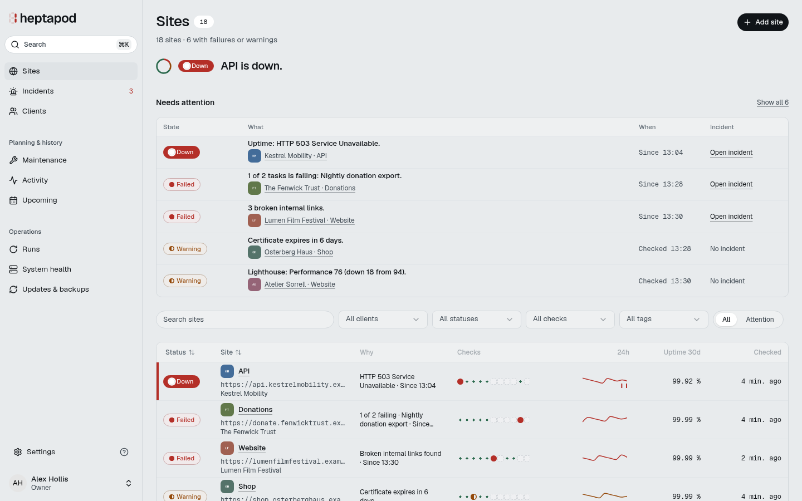

<p align="center">
  <picture>
    <source media="(prefers-color-scheme: dark)" srcset=".github/assets/banner-dark.png">
    
  </picture>
</p>

<p align="center">
  Self-hosted website monitoring for freelancers and small agencies.<br>
  Every client site, watched from one server you own.
</p>

<p align="center">
  <a href="https://heptapod.watch">Website</a> ·
  <a href="https://heptapod.watch/docs/">Docs</a> ·
  <a href="#install">Install</a> ·
  <a href="https://github.com/heptapodwatch/heptapod/releases">Changelog</a> ·
  <a href="https://heptapod.watch/docs/reference/api/">API</a>
</p>

<picture>
  <source media="(prefers-color-scheme: dark)" srcset=".github/assets/sites-dark.png">
  
</picture>

## Why Heptapod

- **You own it.** Heptapod runs with Docker Compose on your server, and results stay in your PostgreSQL database. No subscription, no per-site fees, no account with us.
- **One box for a maintenance retainer.** Uptime, certificates, domains, DNS, broken links, Lighthouse, cron jobs and application health sit on one Sites page, so you stop stitching five tools together.
- **Made for client work.** Group sites by client and give each client its own alert channels, silent until you turn a category on. Send a client the current findings or an incident summary by email, in their language and time zone.
- **Alerts that say what happened.** Each alert names the site, the cause and the time. Alert sensitivity sets how long an outage lasts before anyone is told, maintenance windows mute planned work, and **Who gets this** shows which channels hear about a failure and why the others don't. Alerts go to email, Slack, Microsoft Teams, Discord, Telegram, Pushover, ntfy or a webhook.
- **Ready for scripts and coding agents.** A REST API with scoped tokens, an OpenAPI 3.1 document on every instance, the docs as Markdown at [llms.txt](https://heptapod.watch/llms.txt), and an [agent skill](https://heptapod.watch/docs/reference/coding-agents/) for Claude Code, Codex and others.
- **Coming from Oh Dear.** Import your monitors from Settings or the command line. Heptapod speaks the Oh Dear API format for a tested set of endpoints: point spatie/laravel-health, spatie/laravel-schedule-monitor or the Oh Dear PHP SDK at your instance. Heptapod is not affiliated with Oh Dear.

## What it checks

- [Uptime](https://heptapod.watch/docs/checks/uptime/): status code, expected content and headers.
- [Performance](https://heptapod.watch/docs/checks/performance/): response times from the uptime runs, slow responses and sudden changes.
- [Certificates](https://heptapod.watch/docs/checks/certificates/): expiry and issuer changes.
- [Domain and DNS](https://heptapod.watch/docs/checks/domain-and-dns/): domain expiry, and DNS record changes until you accept them.
- [Broken links and mixed content](https://heptapod.watch/docs/checks/broken-links-and-mixed-content/): a site crawl for dead links and insecure resources.
- [Lighthouse](https://heptapod.watch/docs/checks/lighthouse/): performance, accessibility, best practices and SEO scores.
- [Cron jobs](https://heptapod.watch/docs/checks/cron-heartbeats/): scheduled tasks ping Heptapod; it warns about late finishes and fails missed or failed runs.
- [Application health](https://heptapod.watch/docs/checks/application-health/): what your application reports about itself, in the spatie/laravel-health format.
- [Sitemap](https://heptapod.watch/docs/checks/sitemap/): the sitemap and the URLs it lists.

## Install

```sh
curl -fsSL https://heptapod.watch/install.sh | sudo bash -s -- --domain monitor.example.com --owner-email owner@example.com --without-browser
```

You need an Ubuntu or Debian server (amd64) with 2 vCPU, 4 GB RAM and 40 GB disk, a domain pointing to it and inbound TCP 80/443. For Lighthouse, drop `--without-browser` and use 4 vCPU and 8 GB RAM.

The installer verifies the release bundle, writes the configuration, starts the stack and creates the first Owner. Upgrade with `cd /opt/heptapod && sudo ./scripts/upgrade.sh`.

- [Install guide](https://heptapod.watch/docs/getting-started/install/): every option and an existing reverse proxy.
- [Install from a Git checkout](docs/deploy/operations.md#install-from-a-git-checkout) for other Linux distributions or a source install.
- [Operations](docs/deploy/operations.md): installation details, upgrades, backups, capacity and diagnostics, with a [Hetzner example](docs/deploy/hetzner.md).

## Documentation

`docs/` is the source of truth for this release and is published at https://heptapod.watch/docs/:

- [Check runs](docs/checks/runs.md), [broken links and mixed content](docs/checks/broken-links-and-mixed-content.md), [performance](docs/checks/performance.md) and [sitemap limits](docs/checks/sitemap.md).
- [Notifications](docs/notifications.md), [channel setup](docs/channels.md), [webhook receivers](docs/webhook-receivers.md), [maintenance](docs/maintenance.md), the [API](docs/api.md) and [interface behavior](docs/ui.md).

The app does not serve an API guide at `/docs/api`. Operators distributing these guides must provide an accessible copy alongside their instance.

## Contributing

See [CONTRIBUTING.md](CONTRIBUTING.md) to contribute and [DEVELOPMENT.md](DEVELOPMENT.md) to run Heptapod from source. Follow the [Code of Conduct](CODE_OF_CONDUCT.md), and report vulnerabilities privately as described in [SECURITY.md](SECURITY.md).

## License

[AGPL-3.0-or-later](LICENSE).
