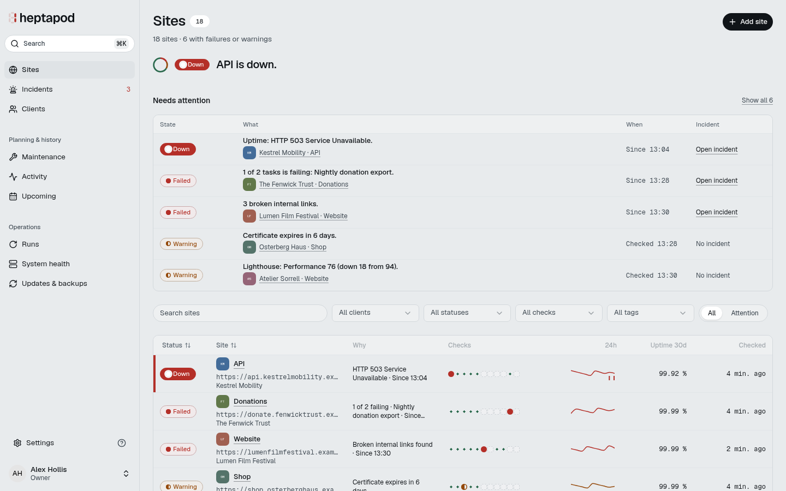

<p align="center">
  <picture>
    <source media="(prefers-color-scheme: dark)" srcset=".github/assets/banner-dark.png">
    
  </picture>
</p>

<p align="center">
  Self-hosted website monitoring for freelancers and agencies.<br>
  Every client site, watched from one server you own.<br>
  Heptapod is young and does not cover everything Oh Dear does: see <a href="#limitations">Limitations</a>.
</p>

<p align="center">
  <a href="https://heptapod.watch">Website</a> ·
  <a href="https://heptapod.watch/docs/">Docs</a> ·
  <a href="#install">Install</a> ·
  <a href="https://github.com/heptapodwatch/heptapod/releases">Changelog</a> ·
  <a href="https://heptapod.watch/docs/reference/api/">API</a>
</p>

<picture>
  <source media="(prefers-color-scheme: dark)" srcset=".github/assets/sites-dark.png">
  
</picture>

## Limitations

Heptapod is not a complete Oh Dear replacement. Some of the gaps below will close; full parity with Oh Dear is not decided and may never happen.

### Not in Heptapod

- No scheduled client reports (monthly email or PDF). You can send a client the current findings or an incident summary by hand.
- No status pages.
- Websites over HTTP only: no ping, TCP or other monitor types.
- Nothing like Oh Dear's AI, ports or DNS blocklist checks.
- All checks run from your one server, not from several locations. Heptapod cannot tell you when that server is down, so [point a heartbeat at an outside service](https://heptapod.watch/docs/running-it/configuration/#watch-the-watcher).

### Notification channels

- [Channels](https://heptapod.watch/docs/alerts/channels/): email, Slack (bot token or incoming webhook), Microsoft Teams (Workflows URL), Discord (bot or webhook), Google Chat, Telegram (your own bot), Pushover, ntfy and webhook.
- No Zoom, PagerDuty, Opsgenie or SMS.
- A channel picks categories (outage, failure, warning …) and can be limited to some check types, but not to single events such as "failed" without "recovered".

### Oh Dear import

- Imported: HTTP monitors as sites, with tags and each check's settings where Heptapod has an equivalent; cron checks, where each task gets a new Heptapod ping URL that you put into the task; maintenance periods and recurring maintenance.
- Under Settings → Import you choose a client for each new site. The command line puts new sites in No client.
- Supported notification channels are imported active or paused as in Oh Dear. Tag and tag-group destinations need an explicit client assignment in Settings → Import.
- Not imported: monitor-level notification destinations, status pages and check history (uptime, downtime, response times, Lighthouse scores).
- Report settings are kept for the Oh Dear-compatible API, but Heptapod sends no reports.
- Skipped: checks this server cannot run (such as Lighthouse without the browser service) and settings without an equivalent (such as crawl speed and probe locations).
- The plan lists skipped checks, settings and notification destinations. After the run, a checklist covers cron ping URLs, status pages and history.

<details>
<summary>Running the import again</summary>

- Choose which sections to import: Sites and checks, Maintenance, Cron checks, Notification channels (`--only=sites,maintenance,cron,channels` on the command line). Leave Sites and checks unticked to keep your site and check settings and to avoid recreating deleted sites.
- Sites and notification channels are matched by their Oh Dear ID, so a rerun creates no duplicates.
- For imported sites, Oh Dear wins. Settings changed in Heptapod are overwritten, and checks are turned on or off as in Oh Dear. A check whose Oh Dear settings are invalid keeps its Heptapod settings.
- A site you deleted in Heptapod is created again. A site you added yourself with the same URL is skipped, not taken over.
- Sites removed from Oh Dear stay in Heptapod.
- Existing sites keep their client, and cron tasks keep their ping URLs.

</details>

More in the [import reference](https://heptapod.watch/docs/reference/api/#import-monitors-from-an-oh-dear-account).

## Why Heptapod

- **You own it.** Heptapod runs with Docker Compose on your server, and results stay in your PostgreSQL database. No subscription, no per-site fees, no account with us.
- **One box for a maintenance retainer.** Uptime, certificates, domains, DNS, broken links, Lighthouse, cron jobs and application health sit on one Sites page, so you stop stitching five tools together.
- **Made for client work.** Group sites by client and give each client its own alert channels, silent until you turn a category on. Send a client the current findings or an incident summary by email, in their language and time zone.
- **Alerts that say what happened.** Each alert names the site, the cause and the time. Alert sensitivity sets how long an outage lasts before anyone is told, maintenance windows mute planned work, and **Who gets this** shows which channels hear about a failure and why the others don't. Alerts go to email, Slack, Microsoft Teams, Discord, Google Chat, Telegram, Pushover, ntfy or a webhook.
- **Ready for scripts and coding agents.** A REST API with scoped tokens, an OpenAPI 3.1 document on every instance, the docs as Markdown at [llms.txt](https://heptapod.watch/llms.txt), and an [agent skill](https://heptapod.watch/docs/reference/coding-agents/) for Claude Code, Codex and others.
- **Coming from Oh Dear.** Import your monitors from Settings or the command line; [not everything carries over](#limitations). Heptapod speaks the Oh Dear API format for a tested set of endpoints: point spatie/laravel-health, spatie/laravel-schedule-monitor or the Oh Dear PHP SDK at your instance. Heptapod is not affiliated with Oh Dear.

## What it checks

- [Uptime](https://heptapod.watch/docs/checks/uptime/): status code, expected content and headers.
- [Performance](https://heptapod.watch/docs/checks/performance/): response times from the uptime runs, slow responses and sudden changes.
- [Certificates](https://heptapod.watch/docs/checks/certificates/): expiry and issuer changes.
- [Domain and DNS](https://heptapod.watch/docs/checks/domain-and-dns/): domain expiry, and DNS record changes until you accept them.
- [Broken links and mixed content](https://heptapod.watch/docs/checks/broken-links-and-mixed-content/): a site crawl for dead links and insecure resources.
- [Lighthouse](https://heptapod.watch/docs/checks/lighthouse/): performance, accessibility, best practices and SEO scores.
- [Cron jobs](https://heptapod.watch/docs/checks/cron-heartbeats/): scheduled tasks ping Heptapod; it warns about late finishes and fails missed or failed runs.
- [Application health](https://heptapod.watch/docs/checks/application-health/): what your application reports about itself, in the spatie/laravel-health format.
- [Sitemap](https://heptapod.watch/docs/checks/sitemap/): the sitemap and the URLs it lists.

## Install

```sh
curl -fsSL https://heptapod.watch/install.sh | sudo bash -s -- --domain monitor.example.com --owner-email owner@example.com --without-browser
```

You need an Ubuntu or Debian server (amd64 or arm64) with 2 vCPU, 4 GB RAM and 40 GB disk, a domain pointing to it and inbound TCP 80/443. For Lighthouse, drop `--without-browser` and use 4 vCPU and 8 GB RAM.

The installer verifies the release bundle, writes the configuration, starts the stack and creates the first Owner. Upgrade with `cd /opt/heptapod && sudo ./scripts/upgrade.sh`.

- [Install guide](https://heptapod.watch/docs/getting-started/install/): every option and an existing reverse proxy.
- [Install from a Git checkout](docs/deploy/operations.md#install-from-a-git-checkout) for other Linux distributions or a source install.
- [Operations](docs/deploy/operations.md): installation details, upgrades, backups, capacity and diagnostics, with a [Hetzner example](docs/deploy/hetzner.md).

## Documentation

`docs/` is the source of truth for this release and is published at https://heptapod.watch/docs/:

- [Check runs](docs/checks/runs.md), [broken links and mixed content](docs/checks/broken-links-and-mixed-content.md), [performance](docs/checks/performance.md) and [sitemap limits](docs/checks/sitemap.md).
- [Notifications](docs/notifications.md), [channel setup](docs/channels.md), [webhook receivers](docs/webhook-receivers.md), [maintenance](docs/maintenance.md), the [API](docs/api.md) and [interface behavior](docs/ui.md).

The app does not serve an API guide at `/docs/api`. Operators distributing these guides must provide an accessible copy alongside their instance.

## Contributing

See [CONTRIBUTING.md](CONTRIBUTING.md) to contribute and [DEVELOPMENT.md](DEVELOPMENT.md) to run Heptapod from source. Follow the [Code of Conduct](.github/CODE_OF_CONDUCT.md), and report vulnerabilities privately as described in [SECURITY.md](.github/SECURITY.md).

## Acknowledgements

Heptapod owes a lot to [Oh Dear](https://ohdear.app). Its focus on what someone who looks after websites actually needs to know shaped many of our choices. If you need the highest reliability, with monitoring that runs independently of your own infrastructure and uptime checks from several locations around the world, Oh Dear is a great choice. Thank you to Mattias Geniar and Freek Van der Herten for building it, and to [Spatie](https://spatie.be) for the open-source packages Heptapod runs on. Heptapod is an independent project and is not affiliated with or endorsed by Oh Dear.

## License

[AGPL-3.0-or-later](LICENSE). The Heptapod name and logo are not covered by the AGPL. Contributions need a signed [Contributor License Agreement](CLA.md).
